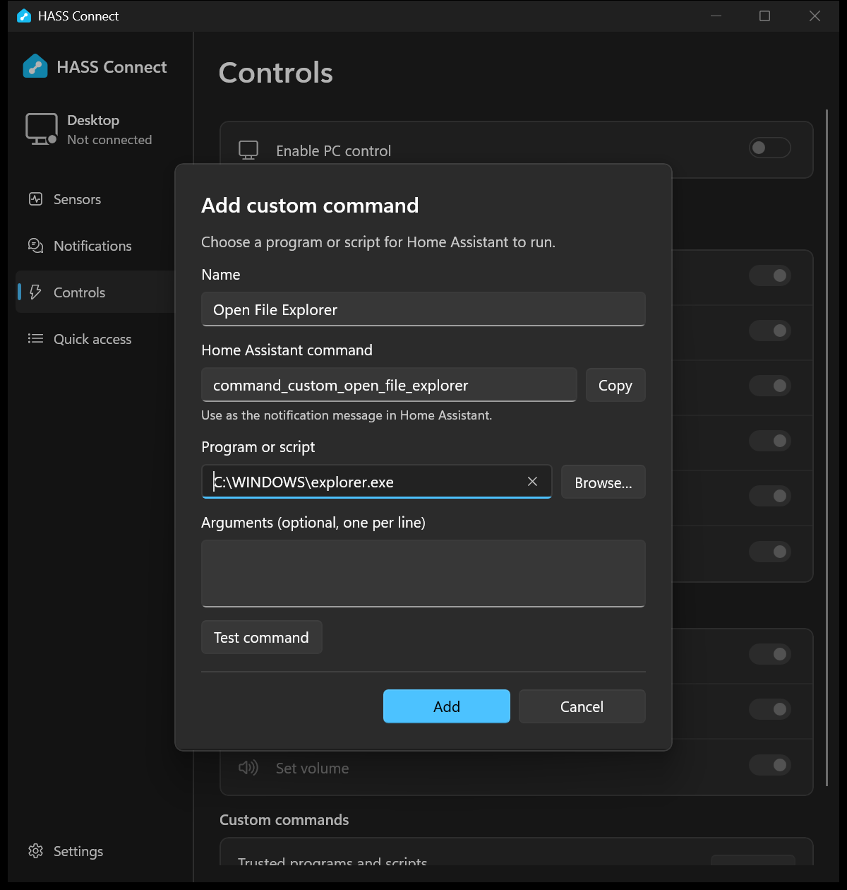

# Custom commands



Custom commands are for the PC actions that HASS Connect does not include out of the box.
You choose a program or script and, for programs, an optional fixed set of launch options.
Home Assistant can run that saved command, but it cannot change the file or its options.

## Add a command

1. Open **Controls** and enable **PC control**.
2. Under **Custom commands**, select **Add**.
3. Give it a name. HASS Connect suggests a command ID; use **Copy** when adding it to a Home Assistant automation.
4. Choose the program or script. Optional arguments appear for `.exe` programs; put one argument on each line.
5. Select **Test command** and check that the right thing happens.
6. Select **Add**. Leave its switch on when you want Home Assistant to use it.

Existing command IDs stay fixed so your automations keep working. **Remove** removes
the saved command, leaving its program or script on the PC. If saving fails, the editor
keeps your input so you can correct the problem and retry.

Use the gear button beside an existing command to edit or remove it. The switch controls
whether Home Assistant may run that command without removing it.

## What to enter

- **Name** is the label shown in HASS Connect.
- **Home Assistant command** starts with `command_custom_`. After that, use a lowercase
  letter, number or underscore, with up to 32 characters after the prefix. It cannot be renamed later.
- **Program or script** is the full path to a local `.exe`, `.bat`, `.cmd` or `.ps1` file.
  Use **Browse** instead of typing the path when possible.
- **Arguments** are available only for `.exe` files. They are fixed on this PC. Enter
  one argument per line; a line containing spaces is still passed as one argument.

HASS Connect accepts up to 20 commands and 16 launch options per `.exe` command. Scripts
do not accept launch options or text supplied by Home Assistant. Script files must be on
a fixed local drive; batch paths cannot contain shell metacharacters (`& | < > ^ % !`).
Missing files, UNC network paths, shortcuts and symbolic links are rejected.

Batch files run through Windows `cmd.exe` with AutoRun and delayed expansion disabled.
PowerShell scripts run through Windows PowerShell with `-NoProfile -NonInteractive -File`;
the system's execution policy still applies. The script runs as your signed-in Windows
account; HASS Connect does not request administrator elevation. It must finish within five
minutes. HASS Connect allows one run of each script at a time and at most four scripts at
once. Check **Settings >
Diagnostic logs** for its exit code or timeout. The file's contents can change after you
approve it, so keep it somewhere only trusted people can edit.

## Trigger it from Home Assistant

Replace `notify.mobile_app_your_pc` with the notify action created for this HASS Connect
device. The notification message must exactly match the saved command name:

```yaml
action: notify.mobile_app_your_pc
data:
  message: command_custom_open_notepad
```

That is the complete Home Assistant action. Do not add a program path or arguments to the
notification: HASS Connect ignores them and uses the values saved on the PC.

## Useful examples

These examples use programs included with Windows. Confirm the path on your PC before
saving.

| Use | Program | Fixed launch options |
| --- | --- | --- |
| Open Notepad | `C:\Windows\System32\notepad.exe` | None |
| Open Calculator | `C:\Windows\System32\calc.exe` | None |
| Open a folder | `C:\Windows\explorer.exe` | The absolute folder path |

For another application, use **Browse** and choose its installed `.exe`.

## What keeps it controlled

- Nothing runs until PC control and that command's switch are both enabled.
- HASS Connect checks the selected file when you save, test and run the command.
- `.exe` programs start directly as your Windows account. Scripts use their respective
  Windows interpreters. Neither path requests administrator elevation.
- Home Assistant cannot send a different program or extra arguments.
- Repeated triggers are rate-limited: once every five seconds for one command and ten
  starts per minute across all custom commands.
- Unknown and disabled commands do not run.

Deleting a command immediately stops its Home Assistant message from working. Deletion
requires confirmation.

## Troubleshooting

- Confirm HASS Connect is running, connected and **PC control** is enabled.
- Confirm the command's switch is enabled and the notification message matches exactly.
- Use **Test command** to separate local launch problems from Home Assistant automation
  problems.
- If the file was moved, use the gear button and select the new file.
- Rapid repeated triggers are intentionally rate-limited; wait before testing again.
- Open **Settings > Diagnostic logs** for validation, launch and connection failures.

Built-in lock, display, sleep, shutdown, restart, media and volume messages are documented in the
[PC command reference](commands.md).
